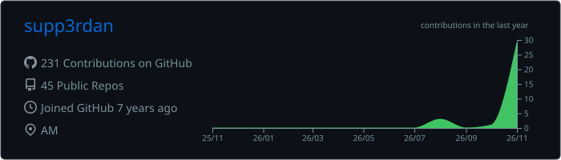
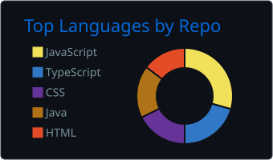
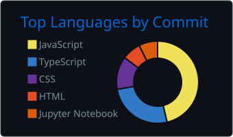
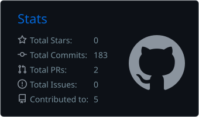
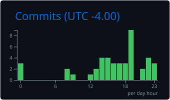

# Sobre mim

Sou **Danrley Carvalho dos Santos**, licenciado em **computação** em uma universidade Estadual. Gosto de transformar problemas do dia a dia em produtos web: sistemas de agendamento, ferramentas para professores e apps que funcionam direto no celular.

Hoje meu foco é o desenvolvimento **full stack com React, Next.js e TypeScript**, banco de dados com **Supabase/PostgreSQL** e o uso de **IA generativa** dentro de aplicações reais.

---

## 🚀 Projetos em destaque

| Projeto | O que é | Stack | Links |
|---|---|---|---|
| 💅 **[Studio Manager](https://github.com/supp3rdan/studio-manager)** | Sistema de agendamento para profissionais de beleza (cílios, sobrancelhas e depilação). Projeto do meu TCC. | Next.js · TypeScript · Supabase · Tailwind | [Acessar](https://studio-manager-three.vercel.app) |
| 📐 **[Proff](https://github.com/supp3rdan/Proff)** | Gera plano de aula, slides e prova com gabarito de Matemática do Ensino Médio usando APIs gratuitas de IA. | Node.js · JavaScript · LLMs | [Acessar](https://supp3rdan.github.io/Proff/) |
| 🏋️ **[Personal](https://github.com/supp3rdan/Personal)** | App (PWA) de Treino ABC de musculação, com timer de descanso, histórico de cargas e uso 100% offline. | React · Vite · Tailwind | [Acessar](https://supp3rdan.github.io/Personal/) |

---

## 🎯 No momento estou focado em

- 🧑‍💻 Desenvolvimento Full Stack com **Next.js** e **TypeScript**
- 🗄️ Modelagem de dados e autenticação com **Supabase**
- 🤖 Integração de **LLMs** em aplicações web
- 🎓 Meu TCC: o **Studio Manager**

---

## 📊 Métricas do GitHub

---

## 🛠️ Tecnologias e ferramentas

### Linguagens

### Web e mobile

### Dados e IA

### Banco de dados, deploy e ferramentas

---

## 🤝 Contato

<!--
  Descomente e preencha os badges abaixo com seus links:

-->

<picture>
  <source media="(prefers-color-scheme: dark)" srcset="https://raw.githubusercontent.com/supp3rdan/supp3rdan/output/github-contribution-grid-snake-dark.svg" />
  <source media="(prefers-color-scheme: light)" srcset="https://raw.githubusercontent.com/supp3rdan/supp3rdan/output/github-contribution-grid-snake.svg" />
  
</picture>

 

Feito por <a href="https://github.com/supp3rdan">supp3rdan</a>

